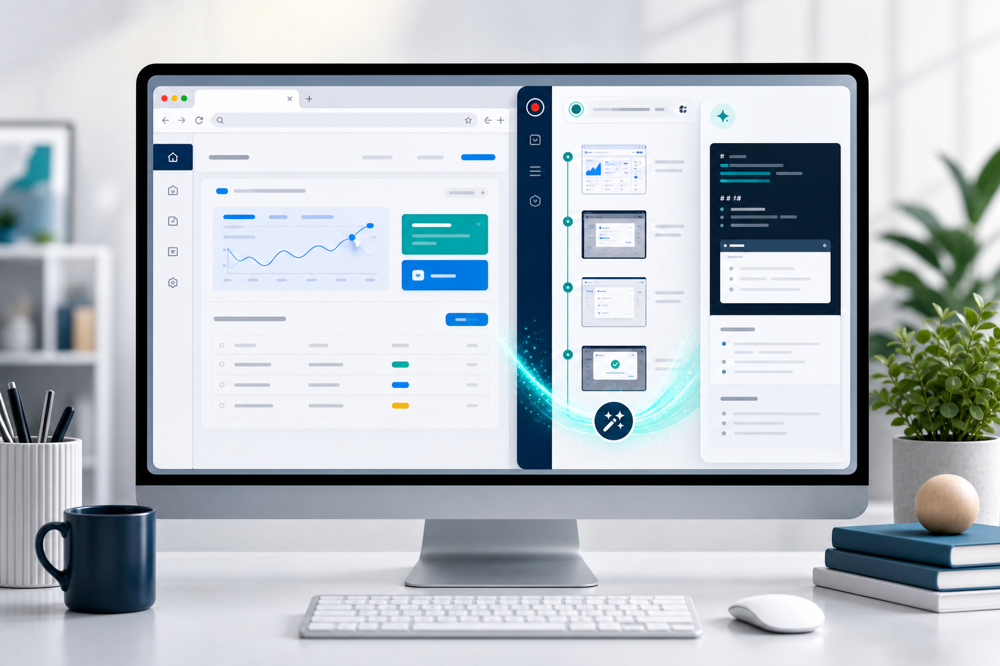
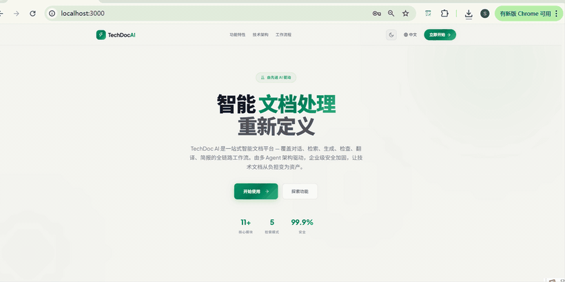

<p align="center">
  
</p>

<h1 align="center">SmartPages</h1>

<h3 align="center">Turn browser workflows into polished documentation.</h3>

<p align="center">
  Record clicks and screenshots once. Generate editable guides, tutorials,<br>
  test cases, and bug reports with the AI model you choose.
</p>

<p align="center">
  <a href="https://github.com/Teddy9710/smartpages/releases/latest"><strong>Download</strong></a> ·
  <a href="#quick-start">Build from source</a> ·
  <a href="docs/examples/README.md">Examples</a> ·
  <a href="#documentation">Documentation</a> ·
  <a href="README.zh-CN.md">中文</a>
</p>

<p align="center">
  
  
  
</p>

<p align="center">
  
</p>

<p align="center"><strong>Record → Generate → Refine → Export</strong></p>

## What can SmartPages create?

<table>
  <tr>
    <td width="33%" align="center">
      <h3>🧭 User guides</h3>
      Record a product workflow and turn it into a clear, step-by-step guide.
    </td>
    <td width="33%" align="center">
      <h3>🧪 Test cases</h3>
      Capture a browser flow and generate structured QA documentation.
    </td>
    <td width="33%" align="center">
      <h3>🐞 Bug reports</h3>
      Reproduce an issue once and preserve every action and screenshot.
    </td>
  </tr>
</table>

SmartPages removes the slow part of documentation: reconstructing every step, screenshot, and explanation after the work is already done.

## How it works

1. **Record** — complete the workflow normally while SmartPages captures actions and screenshots.
2. **Generate** — choose a document goal and generate a draft with GPT, Gemini, Claude, DeepSeek, or another compatible model.
3. **Deliver** — edit or refine the result, then save, copy, or export it in the format you need.

## Quick Start

> For a stable, ready-to-install extension, download the latest package from [GitHub Releases](https://github.com/Teddy9710/smartpages/releases/latest). Build from source when you want to develop SmartPages or try the newest changes.

<p align="center">
  <a href="https://github.com/Teddy9710/smartpages/releases/latest" title="Download the latest SmartPages release">
    
  </a>
</p>

### 1. Build the extension

```bash
git clone https://github.com/Teddy9710/smartpages.git
cd smartpages
npm install
npm run build
```

Promotional images use Git LFS (`git lfs install`, then `git lfs pull`). For packaged
downloads and release instructions, see [repository maintenance](docs/repository-maintenance.md).

### 2. Load it in Chrome or Edge

1. Open `chrome://extensions/` or `edge://extensions/`.
2. Enable **Developer mode**.
3. Select **Load unpacked** and choose the project's `dist/` directory.

### 3. Generate your first document

1. Open SmartPages Settings and configure a model provider.
2. Visit the page you want to document and start recording.
3. Complete the workflow, stop recording, and choose a document goal.
4. Generate, edit, and export the result from the side panel.

> After changing the source, run `npm run build` again and reload the extension. Do not load the source root directly.

## See it in action

<p align="center">
  
</p>

## Key features

### New in 1.4.0

- Recognize scanned PDF pages with the configured vision model while keeping text-based PDF extraction local.
- Preview uploaded documents directly in the document list without storing additional thumbnail images.
- Organize reference documents with custom categories and category filters.
- Share extracted document content through the system share sheet, with clipboard fallback.

- **Capture real workflows:** record clicks, input, SPA navigation, embedded-frame interactions, and step screenshots; pause and resume whenever needed.
- **Generate for the job:** start with goals for guides, tutorials, test cases, and bug reports, or provide a fully custom prompt.
- **Control the output:** apply style guides and examples, choose Markdown or HTML, and configure the maximum token count.
- **Use reference documents:** upload TXT, Markdown, HTML, RTF, PDF, or DOCX files; recognize scanned PDFs, preview and categorize documents, and share extracted content from the document list.
- **Edit before delivery:** refine the rendered document or Markdown source; crop screenshots or add boxes, numbers, blur, and text annotations; then use AI for a second pass when needed.
- **Export anywhere:** copy or export as Markdown, HTML, plain text, Word, ZIP, image, or PDF.
- **Keep your history:** save to an authorized local folder or optionally configure Supabase cloud sync.

## Model support

SmartPages works with:

- **OpenAI-compatible Chat Completions:** OpenAI, Gemini, GLM, DeepSeek, MiniMax, Kimi, OpenRouter, SiliconFlow, DashScope, and custom compatible services.
- **Anthropic Messages API:** Claude models through Anthropic.

You choose the provider, base URL, model, and API key. Each provider keeps an independent connection profile. By default, API keys are stored in this browser's local extension data so they survive extension reloads and browser restarts. Provider limits and pricing remain under your control.

## Privacy by default

- API keys are never committed to the repository or synced by SmartPages. “Remember API Key on this device” stores them in the current browser profile; turn it off to use session-only storage that is cleared when the browser fully closes.
- Recorded content is sent only to the model API you configure when you generate a document.
- Step screenshots are sent only when you explicitly enable image input for a multimodal model; hidden screenshots are excluded and each request is limited to 12 images.
- Uploaded documents are parsed locally whenever possible. Scanned PDF pages are sent to your configured vision model only when you explicitly enable AI OCR, with a limit of 12 pages per document.
- Supabase sync is off by default and uploads only after explicit configuration, sign-in, and save actions.
- Local history can access only a folder you authorize through the browser directory picker.
- Dynamic HTML is sanitized before rendering and export, and extension pages use Manifest V3 CSP.

Avoid recording passwords, tokens, identity numbers, or other sensitive information even though generation prompts request masking.

## Advanced workflows

SmartPages can also export machine-readable `.smartpages.json` workflows, replay them locally with safety checks, and expose approved workflows to local agents through the experimental MCP bridge.

[Read the executable workflow and Local Agent Bridge guide →](docs/advanced-workflows.md)

## Documentation

- [Example documents](docs/examples/README.md)
- [Quick start](QUICKSTART.md)
- [Supabase cloud storage](docs/cloud-storage-supabase.md)
- [Tencent CloudBase storage for mainland China](docs/cloud-storage-cloudbase.md)
- [Advanced workflows and Agent Bridge](docs/advanced-workflows.md)
- [Testing guide](TESTING.md)
- [Troubleshooting](TROUBLESHOOTING.md)
- [Code structure](CODE_STRUCTURE.md)

## Development

```bash
npm run dev         # Build dist/ in watch mode
npm test            # Run the test suite
npm run lint        # Run ESLint
npm run typecheck   # Run TypeScript checks
npm run build       # Generate the loadable dist/ directory
npm run verify      # Run the full verification pipeline
```

Issues and pull requests are welcome. Please read the [English contributing guide](CONTRIBUTING.md) or the [中文贡献指南](CONTRIBUTING.zh-CN.md) before contributing.

## License

SmartPages uses a dual-license model:

| Use case | License | Details |
| --- | --- | --- |
| Personal, educational, and non-commercial use | [GPL v3](LICENSE) | Free to use, modify, and distribute; derivative works must remain open source |
| Commercial use | Commercial license | A separate license is required before integration into commercial products, SaaS services, or enterprise deployments |

The copyright holder (Hongru Wang / 汪鸿儒) retains all commercial rights. For commercial licensing inquiries, contact the author through GitHub Issues.
